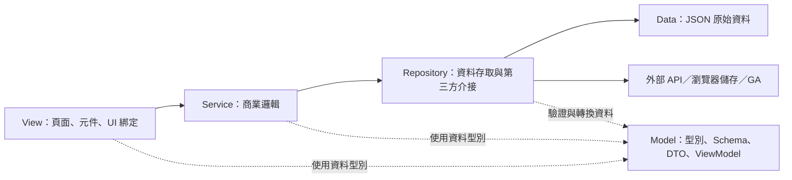

# FreeCivicTW 網站架構

本文件定義網站開發與驗收規範。網站採用 **React + Next.js App Router + TypeScript**，以 **SSG（Static Site Generation）搭配靜態匯出**產生可部署至 GitHub Pages 的網站。

目前尚未定義實際功能與頁面清單；下文的 `Article`（文章）僅用來說明分層、檔案組織與資料流，不代表已確定網站功能。

## 1. 架構目標

- 產出純 HTML、CSS、JavaScript 與靜態資源，正式環境不需要 Node.js 伺服器或資料庫。
- 重要內容於建置時產生完整 HTML，兼顧 SEO、GEO、效能與可存取性。
- 採用 Model、Repository、Service、View 四個邏輯分層。
- 相同業務主題的相關內容，在各層各自集中於同一檔案，避免一個方法、一個型別就拆成一個檔案。
- 業務 JSON 原始資料統一放在根目錄 `Data/`，圖片原始檔統一放在根目錄 `Images/`。
- 提供手機、平板、桌面皆可使用的響應式介面，並整合 Google Analytics 4（GA4）。

## 2. 技術選擇

| 項目 | 選擇與原則 |
| --- | --- |
| UI 框架 | React，由 Next.js 管理頁面與路由。 |
| 網站框架 | Next.js App Router，啟用 `output: 'export'`。 |
| 開發語言 | TypeScript，啟用 `strict`。 |
| 渲染方式 | 主要內容使用 SSG；互動功能以小範圍 Client Components 補強。 |
| 樣式 | Tailwind CSS，搭配 CSS Variables 統一色彩、字級、間距與圓角。 |
| UI 元件 | 有需要時採用 Radix Primitives，補足選單、對話框等互動；不重複引入多套 UI 系統。 |
| 圖示 | `lucide-react`，按需匯入所用圖示。 |
| 資料驗證 | Zod；Schema 定義放在 `Model/`，由 Repository 在資料邊界執行驗證。 |
| SEO | Next.js Metadata API、靜態 sitemap、JSON-LD。 |
| 流量分析 | GA4，透過 Next.js Script 載入 Google Tag。 |
| 套件管理 | 預設使用 npm，提交 `package-lock.json`，CI 使用 `npm ci`。 |
| 部署 | GitHub Actions 建置，GitHub Pages 發布 `out/`。 |

採用上述套件作為初始選型；實作時應確認相容版本、維護狀態與安全公告，再鎖定版本。熱門程度不等於安全保證，不在本文件寫死未驗證的版本號。

套件能力參考：[Tailwind 響應式設計](https://tailwindcss.com/docs/responsive-design)、[Radix 可存取性](https://www.radix-ui.com/primitives/docs/overview/accessibility)、[Lucide React](https://lucide.dev/guide/react/)、[Zod](https://zod.dev/packages/zod)。

## 3. 分層與依賴方向



主要資料流為 `View → Service → Repository → 資料來源`，結果再沿相反方向回傳。Model 是共用資料定義，不是必須依序執行的一個步驟。

### 3.1 Model 層

位置：`src/Model/`。

- 所有自行建立的資料模型、領域型別、DTO、ViewModel、查詢條件、輸入／輸出型別、事件資料結構、錯誤資料結構與驗證 Schema，都放在此資料夾。
- 同主題的 `type`、`interface`、`enum`、Zod Schema 與衍生型別，集中於同一個 `XxxModel.ts`。
- 例如 `ArticleModel.ts` 可以同時包含 `Article`、`ArticleDto`、`ArticleListQuery`、`ArticleCardViewModel`、`ArticleSchema`。
- View 若需要另建資料型別或 Props 資料模型，也放進相應的 Model 檔案；不另設 `Types/`、`Interfaces/`、`DTO/` 分散定義。
- Model 不讀取 JSON、不呼叫 API、不操作瀏覽器，也不依賴 Service、Repository 或 View。
- Schema 負責欄位形狀、型別與格式；發布資格、排序優先級等商業判斷交由 Service。

### 3.2 Repository 層

位置：`src/Repository/`。

- 封裝所有應用資料的存取：JSON、HTTP API、`localStorage`、`sessionStorage`、IndexedDB，以及 GA 等第三方資料介接。
- 負責資料來源位置、請求參數、HTTP 狀態檢查、逾時、必要重試、反序列化、Schema 驗證與技術性欄位轉換。
- 只回傳明確型別的資料或錯誤，不把 `Response`、原始 SDK 物件直接交給 View。
- 不處理發布條件、權限判斷、推薦、業務排序等商業邏輯。
- 以「業務資源／資料集合」為檔案單位，類似後端一個 Repository 處理一張 Table 的概念。
- 例如文章的 `getAll()`、`getBySlug()` 與相應 JSON／API 存取，都集中於 `ArticleRepository.ts`，不拆成 `GetArticleRepository.ts`、`ArticleApi.ts`、`ArticleJsonReader.ts`。
- 若同一資源有 JSON 與 API 兩種來源，相關存取實作仍集中於該資源的 Repository 檔案；不同執行環境的處理見第 6 節。

### 3.3 Service 層

位置：`src/Service/`。

- 封裝全部商業邏輯，包括資料篩選、排序、計算、組合、發布規則、搜尋規則與 ViewModel 組裝。
- 需要資料時呼叫 Repository，不直接 `fetch()`、匯入業務 JSON 或操作儲存空間。
- 可協調多個 Repository，但不得透過其他 Service 繞回自己形成循環依賴。
- 同一業務主題的相關方法與內部輔助函式，集中於同一個 `XxxService.ts`。
- Service 不回傳 JSX，不操作 DOM，不依賴 React 元件。
- 沒有資料存取需求的 Service 可以只處理輸入資料，不必建立空的 Repository。

### 3.4 View 層

邏輯範圍包含 `src/app/` 與 `src/View/`。

- `src/app/` 保留 Next.js 必要的路由、layout、metadata 與靜態路徑入口；`src/View/` 放置頁面呈現及共用 UI。
- View 取得業務資料或執行商業行為時，**直接呼叫 Service**，再把回傳資料綁定至 UI。
- 不必另建 Controller、UseCase 或其他中介層才可呼叫 Service。
- View 不直接呼叫 Repository、不讀業務 JSON、不直接呼叫業務 API，也不自行實作商業規則。
- 可以處理純顯示狀態，例如選單是否展開、目前輸入文字、焦點與對話框開關；搜尋比對、計算及業務篩選仍呼叫 Service。
- 同主題的相關呈現集中於同一 View 檔案；例如 `ArticleView.tsx` 可匯出文章列表與文章詳細呈現。
- Next.js 要求的獨立路由檔案，以及必須區隔的 Client Component 邊界可以保留，不為集中檔案破壞框架規則。

### 3.5 同主題集中檔案的規則

| 主題 | Model | Repository | Service | View |
| --- | --- | --- | --- | --- |
| 文章 | `ArticleModel.ts` | `ArticleRepository.ts` | `ArticleService.ts` | `ArticleView.tsx` |
| 網站設定與導覽 | `SiteModel.ts` | `SiteRepository.ts` | `SiteService.ts` | `SiteView.tsx` |
| 搜尋互動 | `SearchModel.ts` | 有獨立資料來源時才建立 | `SearchService.ts` | `SearchView.tsx` |
| SEO 資料組裝 | `SeoModel.ts` | 通常不需要 | `SeoService.ts` | 由路由入口與共用呈現使用 |
| 分析追蹤 | `AnalyticsModel.ts` | `AnalyticsRepository.ts` | `AnalyticsService.ts` | `AnalyticsView.tsx` |

「同一檔案」指同一層、同一主題集中維護，各層仍分開。不要把全站所有 Model 或所有商業邏輯塞進單一檔案，也不要為每個方法另建檔案。共用程式需有明確責任，不建立收納任意程式的 `CommonService` 或 `UtilsService`。

## 4. 建議目錄

以下是目標結構，實作時只建立實際需要的檔案。資料夾大小寫固定，避免 Windows 可用、GitHub Actions 的 Linux 建置卻失敗。

```text
FreeCivicTW/
├─ Data/                            # 所有業務 JSON 的來源
│  ├─ site.json                     # 網站公開資訊、導覽等
│  └─ articles.json                 # 範例資料集合
├─ Images/                          # 所有圖片來源，含 favicon、分享圖
│  ├─ Site/
│  └─ Article/
├─ Spec/
│  └─ 網站架構.md
├─ src/
│  ├─ app/                          # Next.js 路由入口，屬於 View 層
│  │  ├─ layout.tsx
│  │  ├─ page.tsx
│  │  ├─ not-found.tsx
│  │  ├─ sitemap.ts
│  │  ├─ robots.ts
│  │  ├─ globals.css
│  │  └─ articles/
│  │     ├─ page.tsx
│  │     └─ [slug]/
│  │        └─ page.tsx
│  ├─ Model/
│  │  ├─ ArticleModel.ts
│  │  ├─ SiteModel.ts
│  │  ├─ SearchModel.ts
│  │  ├─ SeoModel.ts
│  │  └─ AnalyticsModel.ts
│  ├─ Repository/
│  │  ├─ ArticleRepository.ts
│  │  ├─ SiteRepository.ts
│  │  └─ AnalyticsRepository.ts
│  ├─ Service/
│  │  ├─ ArticleService.ts
│  │  ├─ SiteService.ts
│  │  ├─ SearchService.ts
│  │  ├─ SeoService.ts
│  │  └─ AnalyticsService.ts
│  ├─ View/
│  │  ├─ ArticleView.tsx
│  │  ├─ SiteView.tsx
│  │  ├─ SearchView.tsx
│  │  ├─ AnalyticsView.tsx
│  │  └─ UI/                       # 可重用的基礎 UI 元件
│  └─ Config/
│     └─ SiteConfig.ts              # 環境設定；不放商業邏輯或業務 JSON
├─ public/
│  ├─ Images/                       # 由 Images/ 產生的發布副本
│  └─ Data/                         # 有瀏覽器讀取需求才產生公開 JSON
├─ scripts/
│  └─ prepare-static-assets.mjs      # 開發／建置前同步公開資源
├─ .github/
│  └─ workflows/
│     └─ deploy-pages.yml
├─ next.config.ts
├─ package.json
├─ package-lock.json
└─ tsconfig.json
```

路徑別名建議：`@/*` 對應 `src/*`；`@data/*` 對應根目錄 `Data/*`，且業務資料只允許 Repository 使用。透過 ESLint import 限制或等效工具檢查分層依賴。

`package.json`、`package-lock.json`、`tsconfig.json` 等工具要求的 JSON 設定檔保留標準位置；`out/`、`.next/` 中的產物也不移動。`Data/` 集中規則適用於網站業務資料來源。

## 5. JSON 與圖片管理

### 5.1 JSON 資料

- 根目錄 `Data/` 是業務 JSON 的唯一人工維護來源，依資料集合命名，例如 `articles.json`。
- 預設由 Repository 在建置時讀取 JSON，驗證後交給 Service，再產生靜態 HTML。
- JSON 欄位可包含穩定 ID、slug、標題、摘要、內容、圖片相對位置、來源連結、發布與更新時間，實際結構由 Model 定義。
- 必填欄位缺漏、型別錯誤、重複 ID／slug 或引用不存在的圖片時，建置失敗並指出資料位置。
- 只有搜尋索引等需要於瀏覽器載入的資料，才由腳本產生精簡的公開副本至 `public/Data/`；不可整包複製 `Data/`。
- 公開副本由 Repository 透過含 `basePath` 的網址讀取，View 與 Service 不自行 `fetch()`。
- 不把金鑰、個資或未發布內容放進公開 JSON、HTML、RSC payload、前端 bundle 或其他發布產物。

### 5.2 圖片資源

- 原始圖片與人工維護的壓縮圖片都放在根目錄 `Images/`，按主題分子資料夾。
- 建置與啟動開發環境前，腳本同步需要公開的圖片至 `public/Images/`；該目錄為生成結果，不手動編輯，並排除版本控制。
- 同步需移除生成目錄中的過期副本，檔案操作範圍只限明確的生成目錄，不刪除原始 `Images/`。
- Next.js 不會自動把根目錄 `Images/` 或 `Data/` 當成公開網址；必須透過上述發布流程。
- 網址例如 `/FreeCivicTW/Images/Article/example.webp`；實際前綴由部署設定決定，不硬編碼在元件。
- `next/image` 採 `images.unoptimized: true`，不依賴 Next.js 執行時圖片最佳化；需要 WebP／AVIF 或不同尺寸時，提前產生靜態圖片。
- 設定正確的圖片尺寸、替代文字與響應式樣式；使用未最佳化圖片時，若需要不同解析度下載，應以預先產生的圖檔搭配 `<picture>`／`srcSet`，不能只靠 `sizes` 假設會自動產生縮圖。
- favicon、Logo、Open Graph 分享圖也從 `Images/` 發布，透過 metadata 指向實際公開路徑。
- 網址及檔名建議使用小寫英數與連字號，引用時精確符合大小寫。

## 6. SSG 與瀏覽器執行邊界

### 6.1 建置時

```text
GitHub Actions／本機建置
  → 準備靜態資源
  → Next.js 路由入口呼叫 Service
  → Service 呼叫 Repository
  → Repository 讀取 Data JSON 或外部 API，驗證 Model
  → Service 套用商業規則，組裝 ViewModel 與 SEO 資料
  → View 產生 HTML，Next.js 匯出至 out/
```

- App Router 的 Server Components 可在建置階段執行；這不代表正式環境需要伺服器。
- 內容型動態路由如 `/articles/[slug]/`，必須由 `generateStaticParams()` 呼叫 Service 列出所有可發布路徑，並設定 `dynamicParams = false`，不保留執行時補建頁面的行為。
- `generateMetadata()` 同樣透過 Service 取得資料；路徑、metadata 與 sitemap 必須使用相同的發布規則。
- 未列入建置的 slug 不會於使用者造訪時自動產生；新增頁面或修改靜態資料後，必須重新建置並部署。
- 建置時呼叫外部 API 的憑證只存在 CI Secrets 與建置環境。Repository 只回傳可發布欄位，不能把憑證或原始敏感回應帶進產物。
- API 建置失敗預設中止發布；若使用快照備援，需明確記錄來源與資料時間，不能悄悄換成空資料。

### 6.2 使用者瀏覽時

```text
靜態 HTML 呈現主要內容
  → Client Component 接收可序列化的 ViewModel
  → UI 互動呼叫可於瀏覽器執行的 Service
  → 必要時由 Repository 讀取公開 JSON／外部公開 API
  → 更新 UI
```

- `use client` 僅加在互動邊界，不把整個網站都改成 Client Component。
- 例如 `SearchView.tsx` 呼叫 `SearchService.search(index, query)`；搜尋資料已傳入時，Service 不必再呼叫 Repository。
- 需要載入搜尋索引時，則由 `SearchService → SearchRepository` 處理，相關方法集中於各自的搜尋主題檔案。
- 建置專用的 Service／Repository 可使用 `server-only` 標記或等效限制，禁止被 Client Component 匯入；不要從共用 barrel export 間接拉進前端。
- 同主題 Repository 若同時支援建置與瀏覽器，須能安全於兩邊載入，不在共用模組頂層引入 `fs`、Secrets 或其他建置專用依賴。做不到時，先明確區分業務責任或必要的執行環境入口，不為湊同一檔案造成洩漏。
- `window`、`document`、儲存空間等瀏覽器 API 僅於瀏覽器生命週期中存取；儲存資料的操作仍封裝於 Repository。
- 瀏覽器 API 請求只使用允許公開、支援 CORS 的端點；需要秘密金鑰的請求安排在建置階段。
- 主要 SEO 內容不能只在 `useEffect` 中抓取後才出現；即時補充資料須標示資料時間及載入／失敗狀態。

### 6.3 靜態部署的功能限制

本架構不使用需要執行時伺服器的 SSR、ISR、Server Actions、依 Request 動態處理的 Route Handlers、API Routes、Proxy／Middleware、伺服器 Session，或執行時的 Next.js redirects、rewrites、headers。不能依賴預設圖片最佳化服務。表單儲存、登入或其他動態功能若未來需要，必須另設外部服務並重新評估架構。

上述靜態匯出行為與限制以 [Next.js Static Exports 官方文件](https://nextjs.org/docs/app/guides/static-exports) 為準。

## 7. GitHub Pages 與網址設定

### 7.1 Next.js 設定基準

```ts
// next.config.ts
import type { NextConfig } from 'next';

const nextConfig: NextConfig = {
  output: 'export',
  trailingSlash: true,
  basePath: process.env.NEXT_PUBLIC_BASE_PATH ?? '',
  images: {
    unoptimized: true,
  },
};

export default nextConfig;
```

- `next build` 直接產生 `out/`；不使用已移除的 `next export` 指令。
- `trailingSlash: true` 讓內容路由輸出為 `路徑/index.html`，配合靜態主機的目錄存取。
- 專案型 Pages 如 `https://<owner>.github.io/FreeCivicTW/`，`basePath` 設為 `/FreeCivicTW`。
- 帳號首頁型 Pages、部署於網域根目錄的自訂網域，以及一般本機開發，`basePath` 設為空字串。
- `basePath` 是建置設定，變更網域或部署子路徑後必須重新建置。
- 不以 `assetPrefix` 代替 `basePath`；目前沒有獨立 CDN 需求，不額外設定它。

### 7.2 環境設定與網址組裝

| 設定 | 用途 |
| --- | --- |
| `NEXT_PUBLIC_SITE_ORIGIN` | 正式網域來源，例如 `https://<owner>.github.io`，不含專案子路徑。 |
| `NEXT_PUBLIC_BASE_PATH` | 空字串或 `/FreeCivicTW`，不含結尾斜線。 |
| `NEXT_PUBLIC_GA_MEASUREMENT_ID` | GA4 Measurement ID，格式為 `G-...`。 |
| `NEXT_PUBLIC_ANALYTICS_ENABLED` | 明確啟用正式站分析；本機與預覽預設關閉。 |

`Config/SiteConfig.ts` 集中讀取及檢查環境設定；正式建置若缺少有效網域，應直接失敗。`NEXT_PUBLIC_*` 會公開至前端，不能放秘密。

`SiteService.ts` 統一提供靜態資源網址與完整公開網址的組裝方法；`SeoService.ts` 使用它建立 canonical、Open Graph、JSON-LD 與 sitemap URL。

- 內部頁面導覽用 `next/link`，傳 `/articles/example/` 等不含前綴的路徑，由 Next.js 自動加上 `basePath`。
- 圖片、公開 JSON、一般原生連結及 CSS 資源網址不假設自動補前綴，使用統一路徑方法，只加一次 `basePath`。
- canonical 等完整網址由 `origin + basePath + route` 組成，不能因 `new URL('/path', base)` 清除專案子路徑。
- 例如同一文章的網址為 `https://<owner>.github.io/FreeCivicTW/articles/example/`，分享圖則為 `https://<owner>.github.io/FreeCivicTW/Images/Site/og-default.jpg`。

連結與圖片的前綴行為參考 [Next.js basePath 官方文件](https://nextjs.org/docs/app/api-reference/config/next-config-js/basePath)。

### 7.3 發布流程

1. 在 GitHub Pages 設定中選擇 GitHub Actions 作為發布來源。
2. PR 執行依賴安裝、分層檢查、型別檢查、必要測試、套件安全掃描與靜態建置。
3. 主分支通過檢查後，使用同一份已驗證的 `out/` 產物發布，不把 Next.js 原始碼當成 Pages 內容。
4. 工作流程使用 `actions/configure-pages`、`actions/upload-pages-artifact` 與 `actions/deploy-pages`；實作時確認受維護版本，正式使用固定的 commit SHA。
5. 建置工作原則上只給 `contents: read`；部署工作另給所需的 `pages: write`、`id-token: write`，使用 `github-pages` environment，並設定部署並行控制。
6. 若改採分支發布，需放置 `.nojekyll` 避免 `_next/` 被 Jekyll 忽略；本文件預設採官方 Actions artifact 流程。

部署後檢查首頁、深層頁直接開啟與重新整理、404、圖片、公開 JSON、分享圖與 sitemap。不能只驗證 `next dev` 正常，還要用靜態伺服器驗證 `out/`，並涵蓋真實專案子路徑。

流程參考 [GitHub Pages 自訂工作流程](https://docs.github.com/en/pages/getting-started-with-github-pages/using-custom-workflows-with-github-pages)。

## 8. SEO 規範

### 8.1 頁面與中繼資料

- 每個可索引頁面具備唯一且符合內容的 `title`、`description`、絕對 canonical URL。
- `layout.tsx` 設定網站標題模板、預設描述、`metadataBase`、圖示與語言；繁體中文頁面使用 `<html lang="zh-Hant">`，Open Graph locale 可用 `zh_TW`。
- 頁面透過 `generateMetadata()` 呼叫 `SeoService` 組裝內容，不在每個 View 重複網址與標題規則。
- 提供 Open Graph 與社群分享 metadata，包含標題、摘要、網址及可公開下載的絕對圖片網址。
- 使用語意化 HTML、清楚的主標題與標題階層、可抓取的 `<a href>` 內部連結與必要麵包屑。
- 圖片提供適當 alt；裝飾圖片使用空 alt。主要文字不只存在於圖片、Canvas 或互動後的畫面。
- 內容在未執行 JavaScript 時仍可由 HTML 讀取；不以整頁載入動畫取代 SSG 內容。
- 統一 slug 與結尾斜線規則。篩選／排序 query 不任意建立重複的可索引網址，canonical 指向對應主要內容頁。
- 404 與不應被索引的頁面設定正確的索引指示；不存在的頁面要有真正的 404 回應，不做全站 SPA fallback。

### 8.2 Sitemap 與 robots

- 由 `src/app/sitemap.ts` 在建置時呼叫 Service，輸出所有可發布、可索引頁面的絕對網址。
- sitemap 的 `lastModified` 使用內容實際更新時間，不把每次部署時間當成全站更新時間。
- `src/app/robots.ts` 產生靜態 robots 檔案，列出正確的 sitemap 網址，不使用執行時 Request 或動態設定；metadata routes 需依所選 Next.js 版本明確配置靜態產生模式，並確認檔案確實存在於 `out/`。
- **專案型 GitHub Pages 的 robots 限制：**爬蟲讀取的是網域根目錄 `/robots.txt`；`/FreeCivicTW/robots.txt` 不能控制整個網域。若能管理 `<owner>.github.io` 根站，於根站配置；否則透過 Search Console 提交專案 sitemap，並以頁面 robots metadata 管理索引。
- 不以 `robots.txt` 作為保密或權限控管，也不以禁止抓取代替 `noindex`。
- 上線後驗證 Google Search Console 網址前綴資源，提交 sitemap，檢查索引與 canonical 判定。

實作參考：[Next.js sitemap](https://nextjs.org/docs/app/api-reference/file-conventions/metadata/sitemap)、[Next.js robots](https://nextjs.org/docs/app/api-reference/file-conventions/metadata/robots)、[Google robots.txt 說明](https://developers.google.com/search/docs/crawling-indexing/robots/intro)、[robots.txt 放置位置](https://developers.google.com/crawling/docs/robots-txt/create-robots-txt)。

### 8.3 結構化資料

- 由 `SeoService` 依真實頁面內容產生 JSON-LD，資料結構定義於 `SeoModel.ts`。
- 依實際用途選擇 `WebSite`、`Organization`、`BreadcrumbList`、`Article` 或 `Dataset`；未具備相應內容時不加入。
- 結構化資料須與頁面可見內容一致，不能捏造作者、評論、組織或更新時間。
- JSON-LD 直接輸出於靜態 HTML。序列化時安全處理 `<` 等可打斷 script 的字元，避免直接插入未處理字串。
- 使用 Rich Results Test 與 Schema Markup Validator 檢查；標記正確不代表一定取得豐富搜尋結果。

輸出方式參考 [Next.js JSON-LD 官方指南](https://nextjs.org/docs/app/guides/json-ld)。

## 9. GEO 規範

本文件的 GEO 指 **Generative Engine Optimization（生成式引擎最佳化）**，目標是讓搜尋及生成式系統容易理解、核對與引用公開內容。

- 每頁聚焦一個明確主題，開頭先提供重點說明，後續使用清楚標題、定義、條件、步驟或表格展開。
- 關鍵資訊以文字呈現並於建置時寫入 HTML，提供穩定網址、可連結的段落錨點與合理內部連結。
- 事實、統計與引用附上原始來源連結、資料時間、適用範圍；必要時區分資料發布時間與網站更新時間。
- 提供真實的作者／維護者、網站介紹、內容維護方式及適用的資料授權資訊，並從頁面連結前往。
- 名稱、數值、單位與分類保持一致；JSON-LD 與頁面內容使用同一份 Model／Service 資料，避免矛盾。
- 有實際問答需求時提供使用者可見的 FAQ，不為了標記而產生大量重複內容。
- 不使用隱藏文字、關鍵字堆疊或對爬蟲顯示不同事實內容的方式。
- `llms.txt` 可作為額外的公開內容導覽實驗，但不是必要條件，也不能當成索引或引用保證；若採用，需與內容同步更新。
- 觀察 Search Console、可辨識的 AI 來源流量與內容成效；無 referrer 的 AI 造訪可能無法辨識，不把 GA 當成完整的 AI 引用統計。

Google 的 AI 搜尋功能沿用 SEO 基礎，未要求特殊 AI 檔案或專用 Schema；此說明適用於 Google，其他引擎需依各自公開規範評估。參考 [Google AI Features and Your Website](https://developers.google.com/search/docs/appearance/ai-features)。

## 10. GA4 分析架構

### 10.1 分層責任

| 位置 | 責任 |
| --- | --- |
| `AnalyticsModel.ts` | 事件名稱、參數與追蹤設定的資料模型。 |
| `AnalyticsRepository.ts` | 封裝 Google Tag／`dataLayer` 呼叫及技術性狀態檢查。 |
| `AnalyticsService.ts` | 事件語意、參數白名單、去識別化、是否允許追蹤等規則。 |
| `AnalyticsView.tsx` | 自動掛載已啟用的 GA 元件並處理 React 生命週期；業務事件轉交 Service。 |

View 的點擊事件呼叫 `AnalyticsService`，不散落直接呼叫 `gtag()`。GA 的 React 掛載元件屬於 View 的技術整合，不把 JSX 放進 Repository 或 Service。

### 10.2 載入與事件

- 使用 Next.js Script 載入 Google Tag，放在共用 layout 的分析整合邊界，避免每頁重複掛載。
- 僅於明確啟用分析且有有效 Measurement ID 時載入；本機、PR 預覽及測試預設關閉。
- 預設以 GA4 Enhanced Measurement 的頁面載入與 browser history 變更追蹤 `page_view`，涵蓋 Next.js 客戶端換頁；不再另寫每次換頁手動送出的追蹤。
- 若未來改成手動 `page_view`，須先停用相應自動追蹤，統一事件時機、頁面網址、標題及來源，避免雙重計數。
- 自訂事件依功能需要加入，例如 `select_content`、`click_external_link`、`download_file`；事件參數由 Model 定義並經 Service 白名單篩選。
- 自動下載或站外點擊追蹤與自訂事件需確認用途，不能把同一操作重複計入同一指標。
- 不把使用者輸入原文、電子郵件、身分識別資訊或敏感 query 寫入 URL／GA；分析用網址需確保不攜帶這些資料。
- 提供隱私說明，明示正式網站自動載入 GA4，可能使用 Cookie 並處理裝置、瀏覽器及網路資訊；不再顯示分析同意詢問。
- GA 載入失敗或被阻擋時，網站主要功能仍正常運作。
- 使用 DebugView 與瀏覽器 Network 檢查首次進站、客戶端換頁、上一頁／下一頁、自訂事件及自動載入行為。

整合與換頁追蹤參考 [Next.js Third-party Libraries](https://nextjs.org/docs/app/guides/third-party-libraries)、[GA4 單頁應用追蹤](https://developers.google.com/analytics/devguides/collection/ga4/single-page-applications)。

## 11. 響應式、視覺與效能

- 採 Mobile First，以內容需要安排斷點；至少驗證 360px、768px、1024px、1440px 寬度。
- 建立一致的色彩、字級、間距、按鈕、表單及卡片規則；使用 Grid／Flex 與流動尺寸，避免主要版面依賴固定像素寬度。
- 手機導覽、長標題、長網址、表格與圖片皆須可正常呈現；表格必要時局部水平捲動，頁面本體不溢出。
- 動畫以 CSS 為優先；確有複雜互動需求才選用經評估的主流套件，並支援 `prefers-reduced-motion`。
- 支援鍵盤操作、可見焦點、適當標籤、表單錯誤提示與足夠色彩對比；以 [WCAG 2.2 AA](https://www.w3.org/TR/WCAG22/) 為設計及檢查目標。
- 元件庫提供的可存取性能力仍需實際驗證，不因用了套件就視為全部符合。
- 圖片設定尺寸避免位移，首屏重要圖片適當優先載入，其餘延遲載入；字型控制字重與檔案大小。
- 可索引主內容使用 SSG；圖表、大型互動與非首屏功能按需載入，控制 Client Component 與前端資料量。
- 建置專用套件、完整原始資料與未使用圖示不應無意間進入前端 bundle。
- 專案效能目標：正式環境第 75 百分位 LCP ≤ 2.5 秒、INP ≤ 200 毫秒、CLS ≤ 0.1；流量不足時先用實驗室工具查找問題，累積真實資料後再驗收。指標參考 [Core Web Vitals](https://web.dev/articles/vitals)。

## 12. 套件與安全維護

- 優先選用有官方文件、持續維護、廣泛採用且授權適用的套件，評估必要性、相依樹、體積、SSG 相容性與已知漏洞。
- 安裝與更新前檢查官方安全公告及依賴掃描結果；不因套件熱門而略過評估。
- 鎖定依賴並提交 lockfile；CI 執行 `npm audit --audit-level=high` 或等效掃描，含建置工具依賴。高／嚴重漏洞未修復前原則上阻擋發布；誤判或不適用須記錄理由與追蹤期限。
- 啟用 Dependabot 或同等更新機制，定期檢查直接與間接依賴；更新後重跑受影響檢查，不盲目執行破壞性自動升版。
- 不在前端放 API Secrets；對外請求採 HTTPS，只有必要功能才載入第三方 script。
- 預設使用 React 的文字跳脫；需要呈現外來 HTML 時，先經明確的清理流程與允許清單，避免任意 `dangerouslySetInnerHTML`。
- Repository 驗證資料邊界，Service 驗證業務規則；錯誤訊息不得顯示憑證或敏感 API 回應。
- GitHub Actions 使用最小權限與固定 action SHA，未受信任的 PR 不取得正式部署憑證。
- GitHub Pages 無法直接套用 Next.js 執行時自訂回應 headers；若後續需要 CSP 等策略，須確認靜態 meta 方式的能力與限制，或重新評估前置託管設定，不能只在 `next.config.ts` 寫 `headers()`。

## 13. 開發與驗收

開發順序建議：先確認頁面與資料集合，再建立 Model、Repository、Service、View，最後串接 SSG、SEO、GA 與發布流程。新增主題時沿用相同命名與分層方式，不預先建立沒有用途的抽象層。

完成實作後，至少確認：

- [ ] React + Next.js App Router 可透過 `next build` 產出 `out/`，正式站不依賴 Node.js 執行時。
- [ ] View 只透過 Service 處理商業行為，所有應用資料存取集中於 Repository。
- [ ] 資料型別與 Schema 都在 Model；同層、同主題的方法與定義集中維護。
- [ ] 業務 JSON 原始檔在 `Data/`，圖片原始檔在 `Images/`，公開副本可重建且不含敏感資料。
- [ ] 關鍵 Service 規則與 Repository 資料驗證具有適量的行為測試，不為單純轉呼叫建立無效測試。
- [ ] 必要的 lint、分層依賴檢查、TypeScript、測試、安全掃描與靜態建置皆通過。
- [ ] 所有內容動態路由已預先列出，新增／刪除資料可正確同步頁面與 sitemap。
- [ ] 用靜態伺服器驗證根路徑與 GitHub Pages 子路徑，包括深層頁重整、404 與資源路徑。
- [ ] 每頁具備正確 metadata、canonical、分享圖片與適用的 JSON-LD；主要內容存在於原始 HTML。
- [ ] sitemap 使用正式完整網址，robots 配置考量網域根目錄限制，Search Console 可完成驗證與提交。
- [ ] GEO 內容具備清楚主題、可核對來源、真實維護者及資料更新時間。
- [ ] GA4 首次進站與換頁計數正確，自訂事件無重複，並驗證自動載入與敏感參數過濾。
- [ ] 手機、平板、桌面版面、鍵盤操作、焦點、對比與減少動畫偏好皆完成檢查。
- [ ] 圖片與前端 bundle 大小合理，效能量測方式與結果有記錄。
- [ ] GitHub Actions 僅發布已通過檢查的靜態產物，部署後完成必要頁面巡檢。
